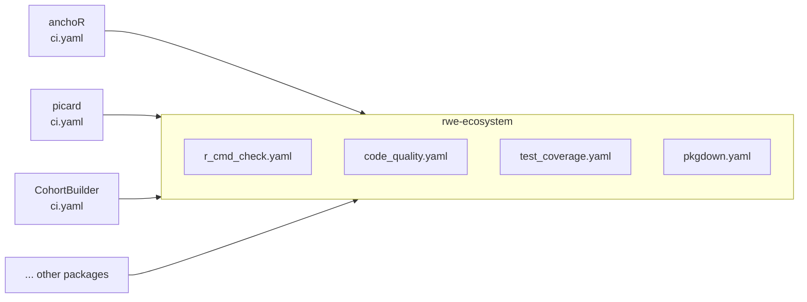
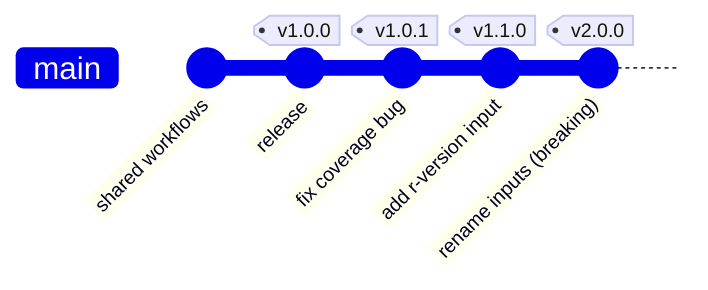

# Shared CI workflows and versioning

This page explains how the packages in the RWE ecosystem share one set of
GitHub Actions workflows, and how we release new versions of those workflows
without breaking anyone's CI.

## 1. The idea in one paragraph

The CI logic (R CMD check, linting, coverage, pkgdown) lives **once**, in this
repository, under `.github/workflows/`. Each package (anchoR, picard,
CohortBuilder, ...) contains only a small `ci.yaml` that says *"run the shared
workflows from rwe-ecosystem"*. When we improve or fix a shared workflow, every
package picks up the change without anyone editing the packages.



## 2. How a package calls a shared workflow

A package's `.github/workflows/ci.yaml` contains jobs like this:

```yaml
jobs:
  coverage:
    uses: UMC-Utrecht-RWE/rwe-ecosystem/.github/workflows/test_coverage.yaml@v1
    with:
      threshold: 70
```

Read the `uses:` line left to right:

| Part | Meaning |
|---|---|
| `UMC-Utrecht-RWE/rwe-ecosystem` | the repository that holds the workflow |
| `.github/workflows/test_coverage.yaml` | the file inside that repository |
| `@v1` | **which version** of the repository to take the file from |
| `with:` | settings the shared workflow accepts (its `inputs`) |

The template to copy into a package is
[`templates/r-package/starter/.github/workflows/ci.yaml`](../templates/r-package/starter/.github/workflows/ci.yaml).

### Starter and managed files

Packages also need a few config files of their own. They come in two kinds:

| Folder | Files | Rule |
|---|---|---|
| `templates/r-package/starter/` | `ci.yaml`, `pull_request_template.md`, `.lintr`, `.pre-commit-config.yaml`, `.covrignore`, `.Rbuildignore`, `.gitignore`, `.vscode/`, `_pkgdown.yml`, `NEWS.md` | copy once, then the package may adapt them (replace `PACKAGE` with the package name) |
| `templates/r-package/managed/` | `air.toml` | copy **unchanged**; CI fails if the package's copy is missing or differs |

The package keeps its own copy of a managed file so local tools (Air in the
editor, pre-commit) read it, but rwe-ecosystem remains the single source of
truth: `code_quality.yaml` downloads the managed file from the same major
version tag (e.g. `v2`) and compares. Changing a managed file can make every
package's CI fail, so it is a **major** release (section 5).

## 3. What is `@v1`?

Everything after `@` is a **git reference**: a name that points to one specific
commit. GitHub fetches the workflow file as it was at that commit. There are
three kinds of reference you could put there:

| Reference | Example | Points to | Behaviour |
|---|---|---|---|
| Branch | `@main` | the latest commit on `main` | changes on every push |
| Tag | `@v1`, `@v1.0.0` | a commit we chose | changes only when we deliberately move it |
| Commit SHA | `@3f2a9c1...` | one exact commit | never changes |

We use a **tag**. A tag is just a label stuck on a commit, like a bookmark. It
has to exist in the repository, which is why we create it ourselves. Until the
tag `v1` exists, every package's CI fails with *"workflow was not found"*.

### Why not just use `@main`?

With `@main`, every commit merged into this repository immediately changes CI
for **every** package. One typo in a shared workflow would turn every package's
CI red at once. A tag lets us test changes on `main` first and only then
"publish" them to the packages.

## 4. Two kinds of tag: fixed and moving

We create two tags for each release. This is the same scheme GitHub's own
actions use (it is why our workflows say `actions/checkout@v4`).

| Tag | Example | Moves? | Purpose |
|---|---|---|---|
| **Fixed** (full version) | `v1.0.0`, `v1.0.1`, `v1.1.0` | **Never** | a permanent record of exactly what each release contained |
| **Moving** (major version) | `v1` | **Yes**, to each new compatible release | what packages reference in `ci.yaml` |

Packages always point at `@v1`. We move `v1` forward when we release a fix or a
new feature, so packages get it automatically.



In this history:

- `v1.0.0`, `v1.0.1`, `v1.1.0`, `v2.0.0` each stay on the commit shown, forever.
- `v1` first pointed at `v1.0.0`, was moved to `v1.0.1`, then to `v1.1.0`.
  Packages using `@v1` received the bug fix and the new input without any edits.
- The breaking change got `v2` instead. `v1` stays on `v1.1.0`, so packages
  still on `@v1` keep working, and each package switches to `@v2` when ready.

### What does "moving a tag" mean?

Normally git refuses to create a tag that already exists. To move `v1` to a new
commit we **force** it:

```bash
git tag -f v1           # re-point the local v1 tag to the current commit
git push -f origin v1   # replace v1 on GitHub with the new position
```

`-f` (force) is needed **only** for the moving tag. Never force-move a fixed
tag like `v1.0.0`: its whole point is that it never changes.

## 5. Which version number to bump

We follow [semantic versioning](https://semver.org): `vMAJOR.MINOR.PATCH`.

| Change to the shared workflows | Example | New fixed tag | Move `v1`? |
|---|---|---|---|
| Bug fix, no change for callers | fix the coverage file listing | `v1.0.0` → `v1.0.1` | yes |
| New optional input or feature; old `ci.yaml` files still work | add an `r-version` input with a default | `v1.0.1` → `v1.1.0` | yes |
| Breaking: an existing `ci.yaml` could fail or behave differently | rename/remove an input, change a default threshold, remove a job | `v1.1.0` → `v2.0.0` | **no**, create `v2` |

Rule of thumb: **if a package would need to edit its `ci.yaml`, or could start
failing without changing its code, it is a major version.**

## 6. Step-by-step procedures

All commands are run in a local clone of `rwe-ecosystem`, on an up-to-date
`main`, after the change has been merged through a pull request.

### 6.1 First release (one time only)

```bash
git switch main && git pull
git tag v1.0.0
git tag v1
git push origin v1.0.0 v1
```

Both tags now point at the same commit.

### 6.2 Patch or minor release (bug fix or new optional feature)

```bash
git switch main && git pull
git tag v1.0.1                  # new fixed tag (or v1.1.0 for a feature)
git push origin v1.0.1
git tag -f v1                   # move the moving tag to this commit
git push -f origin v1
```

From the next CI run, every package using `@v1` uses the new version.

### 6.3 Major release (breaking change)

```bash
git switch main && git pull
git tag v2.0.0
git tag v2
git push origin v2.0.0 v2
```

Do **not** move `v1`. Then, in each package, open a PR that changes `@v1` to
`@v2` in `ci.yaml` and applies whatever else the breaking change requires.
Describe what changed and how to migrate in [`CHANGELOG.md`](../CHANGELOG.md).

### 6.4 Checking where tags point

```bash
git fetch --tags --force        # --force picks up tags moved on GitHub
git log --oneline --decorate -5 # tags are shown next to commits
git show v1 --no-patch          # the commit v1 points to
```

### 6.5 Rolling back a bad release

If a release breaks package CI, move `v1` back to the previous good release:

```bash
git tag -f v1 v1.0.0            # point v1 at the commit tagged v1.0.0
git push -f origin v1
```

Then fix the problem on `main` and release a new patch version.

## 7. Testing a change before releasing it

Before moving `v1`, try the change on a real package:

1. Push your change to a branch in `rwe-ecosystem`, e.g. `fix-coverage`.
2. In a package, open a draft PR that temporarily changes the reference to
   `@fix-coverage`:
   ```yaml
   uses: UMC-Utrecht-RWE/rwe-ecosystem/.github/workflows/test_coverage.yaml@fix-coverage
   ```
3. If CI passes, merge the `rwe-ecosystem` PR, release as in section 6, and
   close the draft PR without merging it.

## 8. One-time GitHub settings

- **Workflow access.** If `rwe-ecosystem` is private or internal: *Settings →
  Actions → General → Access* → allow access from repositories in the
  organization. Without this, packages cannot see the workflows.
- **pkgdown permissions.** The `pkgdown` job in a package's `ci.yaml` must
  grant `permissions: contents: write`, so it can push the site to the
  `gh-pages` branch. The template already does this.

## 9. FAQ

**A package needs different settings. Do I copy the workflow?**
No. Use the `with:` inputs in its `ci.yaml` (for example `threshold`,
`error-on`, `matrix`). If an input you need does not exist, add it to the
shared workflow with a default that preserves current behaviour (a minor
release).

**I changed a shared workflow on `main` but packages don't see it.**
Expected: packages use `@v1`, not `@main`. Release it (section 6.2).

**Why does a package's CI suddenly fail without changes to its code?**
Someone moved `v1` to a release that changed behaviour. Check `CHANGELOG.md` and
the recent tags (section 6.4); roll back if needed (section 6.5).
